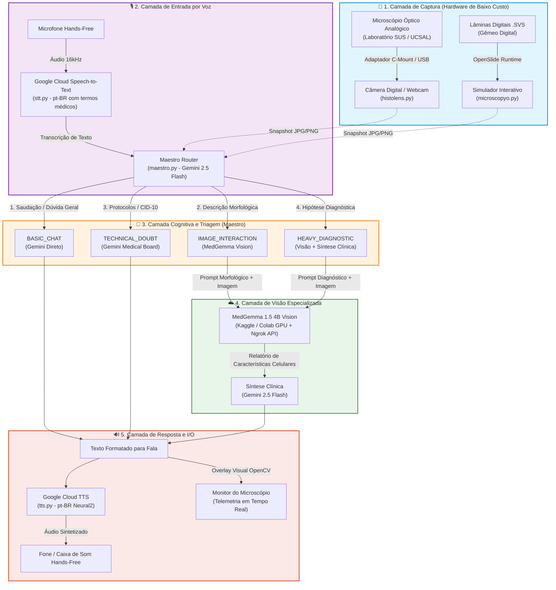

# HistoLens SmartScope AI

<div align="center">

[](LICENSE)
[](https://www.python.org/)
[](https://cloud.google.com/)
[](https://www.kaggle.com/code/erickfjsantos/histolens-smartscope-medgemma-processing-api)
[](https://deepmind.google/technologies/gemini/)
[](https://www.ucsal.br/)

**Assistente Inteligente de Baixo Custo para Histopatologia e Suporte à Triagem Laboratorial na Saúde Pública (SUS)**

[🇧🇷 Visão Geral e Extensão UCSAL (Português)](#-visão-geral--projeto-de-extensão-universitária-ucsal) • [Fluxograma de Arquitetura](#-fluxograma-de-arquitetura) • [Instalação e Execução](#-instalação-e-execução) • [🇺🇸 English Version](#-english-version)

</div>

---

## 🇧🇷 Visão Geral — Projeto de Extensão Universitária (UCSAL)

O **HistoLens SmartScope AI** é uma plataforma assistiva multimodal (voz e visão computacional) desenvolvida sob a filosofia *Edge-to-Cloud de Baixo Custo*. O projeto visa transformar microscópios ópticos convencionais já presentes em laboratórios universitários e postos de saúde pública em **estações de microscopia digital inteligente**, permitindo que o profissional de saúde e o estudante operem com assistência diagnóstica por inteligência artificial em modo **100% mãos-livres (hands-free)**.

### 🏥 Justificativa Social e Alinhamento com o SUS
1. **Gargalo de Diagnóstico no SUS**: Exames citopatológicos e histopatológicos (ex: rastreamento de câncer de colo de útero pelo exame Papanicolau, biópsias de mama e gástricas) enfrentam longas filas de espera devido à escassez crítica de médicos patologistas em regiões periféricas e do interior.
2. **O Abismo Tecnológico da Patologia Digital**: Scanners comerciais de lâminas inteiras (*Whole Slide Imaging - WSI*) custam entre **R$ 300.000 e mais de R$ 1.000.000**, o que inviabiliza sua aquisição pela maioria dos laboratórios municipais, estaduais e universitários conveniados ao SUS.
3. **A Solução HistoLens**: Em vez de exigir scanners milionários, o HistoLens acopla **câmeras digitais acessíveis (USB/C-mount ou adaptadores ópticos para smartphone de R$ 150 a R$ 500)** à ocular de microscópios ópticos analógicos existentes, conectando a imagem em tempo real a modelos de fundação médica em nuvem (*MedGemma 4B* e *Gemini*).
4. **Ergonomia e Biossegurança em Laboratório**: O operador interage com a IA por comandos de voz enquanto manipula o micrômetro/charriot do microscópio, sem precisar retirar luvas para digitar em teclados ou usar mouses, prevenindo contaminação cruzada e fadiga.

### 🎯 Alinhamento aos Objetivos de Desenvolvimento Sustentável (ODS - ONU)
- **ODS 3 — Saúde e Bem-Estar (Meta 3.4)**: Fortalecer o diagnóstico precoce e a triagem preventiva de neoplasias e patologias prevalentes na saúde pública.
- **ODS 9 — Indústria, Inovação e Infraestrutura**: Inovação tecnológica frugal e aberta voltada à modernização da infraestrutura laboratorial pública.
- **ODS 10 — Redução das Desigualdades**: Democratizar ferramentas avançadas de inteligência artificial em centros de saúde descentralizados.

### ⚖️ Enquadramento Ético e Regulatório
> **Aviso Importante**: O HistoLens atua estritamente como **Sistema de Apoio à Decisão Clínica (CDSS)**, pré-triagem morfológica e ferramenta de capacitação pedagógica. **Não emite laudos definitivos nem substitui o julgamento do médico patologista responsável.**

---

## 📐 Fluxograma de Arquitetura

O sistema opera em um modelo híbrido *Edge-to-Cloud* desacoplado em 5 camadas lógicas:



---

## 🧩 As 5 Camadas do Sistema

1. **Camada de Captura**:
   - `histolens.py`: Conecta a qualquer câmera USB/microscópio real (`cv2.VideoCapture`), gerencia a interface em tempo real e captura quadros sob demanda.
   - `microscopyo.py`: Gêmeo digital baseado em OpenSlide que navega por lâminas histopatológicas inteiras (`.svs`), permitindo testes e simulações mesmo sem acesso imediato a hardware físico.
2. **Camada de Entrada por Voz (`stt.py`)**:
   - Transcrição contínua em Português (`pt-BR`) com vocabulário induzido por contexto médico (ex: *neoplasia, carcinoma, mitose, displasia, atipia, Papanicolau*).
3. **Camada Cognitiva de Roteamento (`maestro.py`)**:
   - Roteador semântico baseado em Gemini Flash que avalia a intenção do operador e despacha a requisição para a rota de menor custo e menor latência.
4. **Camada de Visão Histopatológica Remota (`medgemma.py`)**:
   - Conexão HTTP REST com o modelo **MedGemma 1.5 4B** hospedado em ambiente de GPU remota (Kaggle Notebook / Colab) via túnel seguro Ngrok. Extrai evidências celulares (núcleos, citoplasma, padrão de coloração e arquitetura tecidual).
5. **Camada de Síntese Clínica e Fala (`tts.py` / `maestro.py`)**:
   - Transforma achados brutos de visão em orientações faladas sucintas em linguagem médica natural, reproduzidas pelo Google Text-to-Speech (`pt-BR-Neural2-A`).

---

## 🚀 Instalação e Execução

### Pré-requisitos
- Python 3.10+ (recomendado 3.10 ou 3.11)
- Chave de API do Google Gemini (`GOOGLE_API_KEY`)
- Credenciais do Google Cloud para Speech-to-Text e Text-to-Speech (`GOOGLE_APPLICATION_CREDENTIALS`)
- Endpoint ativo do notebook MedGemma ([Notebook no Kaggle](https://www.kaggle.com/code/erickfjsantos/histolens-smartscope-medgemma-processing-api)) com Ngrok.

### 1. Clonagem e Configuração do Ambiente
```bash
git clone https://github.com/ErickFJSantos314/Projeto-de-extens-o-UCSAL-Histolens.git
cd Projeto-de-extens-o-UCSAL-Histolens

python -m venv venv
# Windows:
.\venv\Scripts\activate
# Linux/macOS:
source venv/bin/activate

pip install -r requirements.txt
```

### 2. Configurar Variáveis de Ambiente (`.env`)
Copie o modelo de configuração:
```bash
copy .env.example .env
```
Preencha o arquivo `.env` com suas credenciais:
```env
GOOGLE_API_KEY=sua_chave_gemini_aqui
REMOTE_VISION_API_URL=https://seu-endpoint-ngrok.ngrok-free.dev/analyze
GOOGLE_APPLICATION_CREDENTIALS=C:/caminho/para/service-account.json

# Localização (padrão em Português do Brasil)
HISTOLENS_LANGUAGE_CODE=pt-BR
HISTOLENS_TTS_VOICE_NAME=pt-BR-Neural2-A

# Parâmetros de Hardware
HISTOLENS_CAMERA_INDEX=0
HISTOLENS_FRAME_WIDTH=1280
HISTOLENS_FRAME_HEIGHT=720
```

### 3. Executando em Tempo Real com Câmera no Microscópio
No Windows:
```bash
run_histolens.bat
# ou diretamente via Python:
python histolens.py
```
Controles do `histolens.py`:
- `R`: Pressione para iniciar a gravação de voz com sua dúvida/comando; pressione novamente para parar e processar.
- `X`: Finalizar o programa.

### 4. Executando no Modo Gêmeo Digital (Simulação sem Microscópio)
Para testar lâminas digitais inteiras (`.svs`):
```bash
set HISTOLENS_SVS_PATH=archives\sua_lamina.svs
python microscopyo.py
```
Controles do `microscopyo.py`:
- `W / A / S / D`: Mover o campo de visualização da lâmina.
- `Q / E`: Zoom - / Zoom +
- `R`: Gravar comando de voz
- `X`: Sair

---

## 👥 Equipe do Projeto de Extensão (UCSAL)

- **Erick Francisco** — [LinkedIn](https://www.linkedin.com/in/erick-francisco-28a756274/)
- **David Antonio** — [LinkedIn](https://www.linkedin.com/in/david-antonio-29807434a/)
- **Samara Souza** — [LinkedIn](https://www.linkedin.com/in/samara-souza-szp/)
- **Maria Clara Paixão** — [LinkedIn](https://www.linkedin.com/in/maria-clara-paix%C3%A3o-2061362a0/)
- **Nayara Lorena** — [LinkedIn](https://www.linkedin.com/in/nayara-lorena-ramos-santos-73b904274/)

---

## 🇺🇸 English Version

### Overview
**HistoLens SmartScope AI** is a layered, cloud-edge pathology assistant for hands-free microscope workflows, combining real-time speech interaction, intent-aware AI routing, remote medical vision inference with **MedGemma 4B**, and spoken clinical feedback.

Originally engineered during a Google-sponsored hackathon, this repository serves as the practical implementation for the **University Extension Project (UCSAL)**, targeting affordable digital pathology and clinical triage support for public healthcare centers (SUS).

### Key Features
- **Affordable Hardware Integration**: Interfaces with standard optical laboratory microscopes via inexpensive USB/C-mount cameras ($30-$80) rather than whole-slide scanners costing over $100,000.
- **Hands-Free Laboratory Ergonomics**: High-accuracy Speech-to-Text with medical vocabulary context allows technicians and pathologists to query slide findings without taking hands off microscope controls.
- **Cost-Optimized Dual-AI Routing**: Maestro cognitive layer triages queries using Gemini Flash before calling GPU-heavy vision endpoints.
- **Remote Specialized Vision**: Offloads morphological extraction to MedGemma 1.5 4B running on remote cloud GPUs.
- **Digital Twin Simulation**: Includes `microscopyo.py` with OpenSlide support to simulate high-resolution `.svs` whole-slide examination when laboratory hardware is unavailable.
